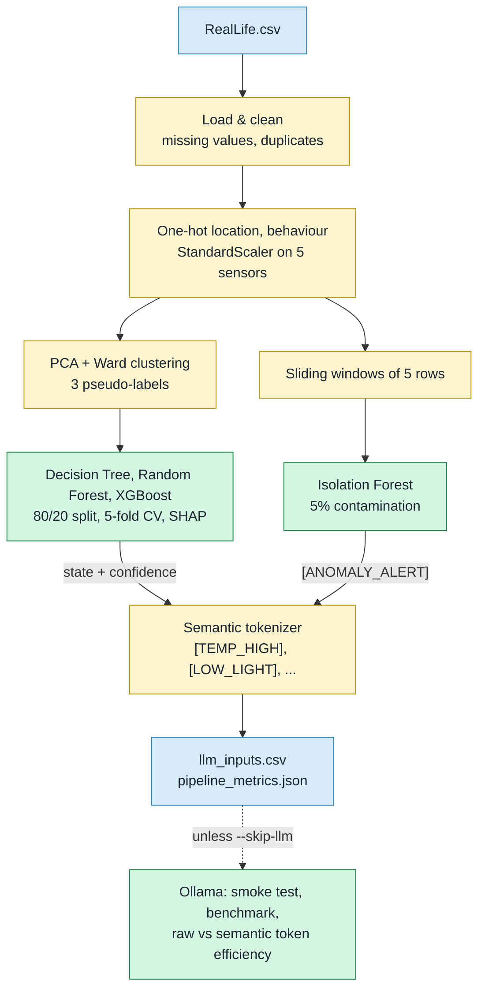
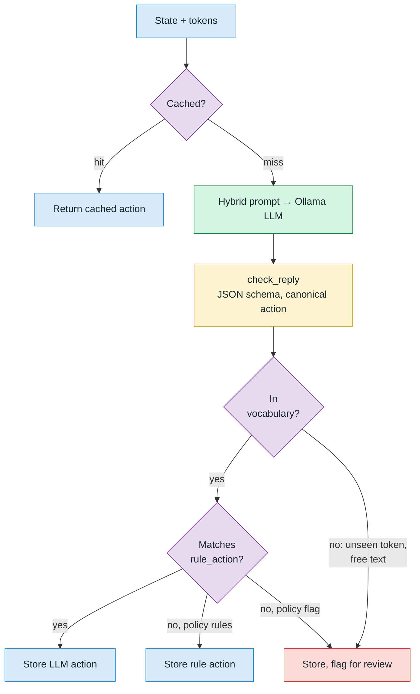
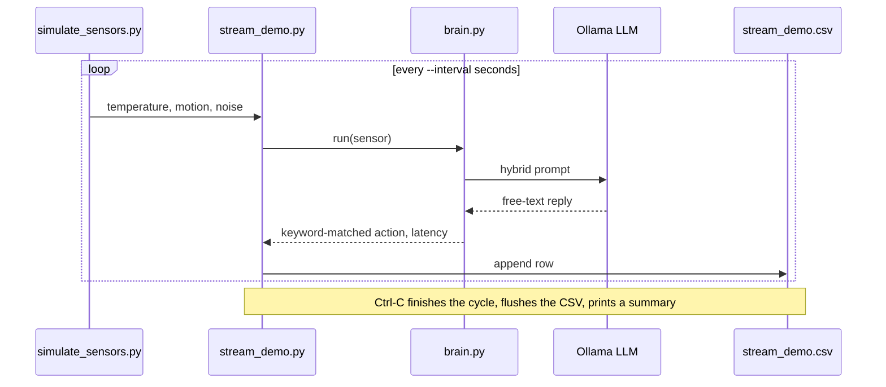
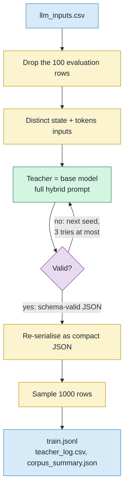
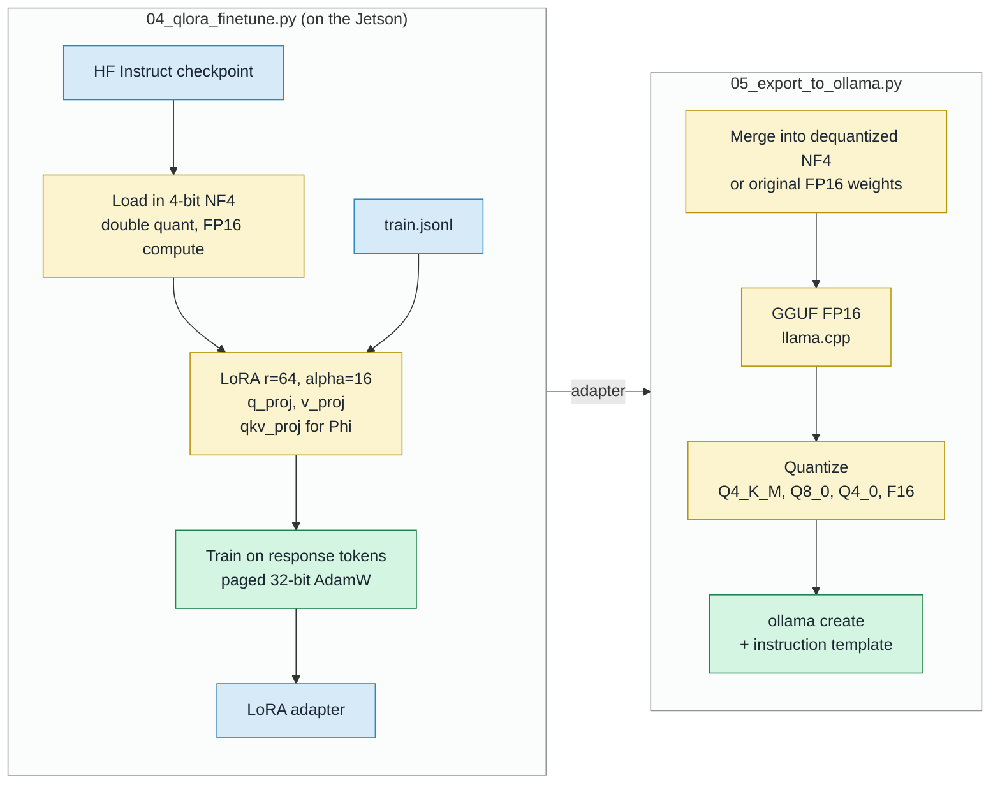
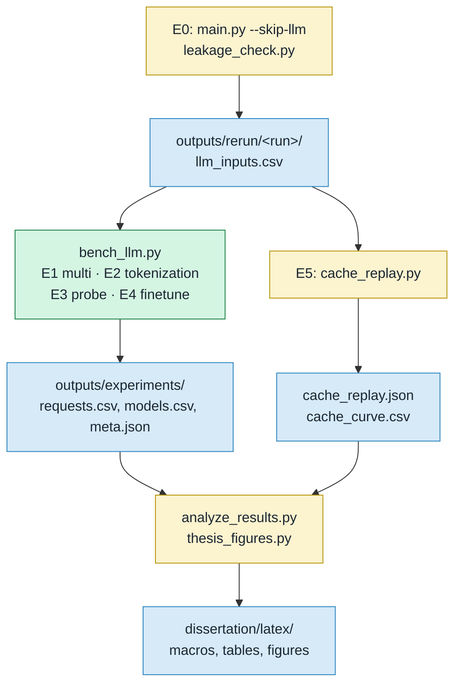

# EdgeIOT Project Diagrams

Colours are the same in every diagram: blue = data/files, yellow = processing step, green = model or LLM, purple = decision, red = review/fallback.

## 1. ML Pipeline (`main.py`)

Every stage also writes its plots to `outputs/<run>/plots/`.

## 2. LLM Decision, Rule Baseline and Response Cache

`scripts/cache_replay.py` replays the test rows through this cache, using LLaMA 3.2's logged replies instead of new inference.

## 3. Demo Streaming Loop (`scripts/stream_demo.py`)

`scripts/run_demo.py` runs the same cycle a fixed number of times and appends to `outputs/baseline_demo.csv`.

## 4. Training Corpus (`scripts/02_make_train_data.py`)

Each model gets its own self-distilled corpus: `data/finetune` (LLaMA 3.2), `data/finetune_qwen`, `data/finetune_phi`.

## 5. QLoRA Fine-Tuning and Export

`scripts/run_finetune.sh` trains LLaMA 3.2, Qwen 2.5 and Phi-3.5; `scripts/run_ft_chain_all.sh` exports every variant (`edgeiot-*-ft-merged` and the chain variants) and evaluates it. `scripts/diagnose_ft_chain.py` compares the adapter's answers on the NF4 and FP16 base to locate where along this chain a fine-tuned model changes.

## 6. Experiments and Analysis

`bench_llm.py` also samples `tegrastats` (GPU load, RAM, temperature, board power) during every request; E3 uses the cases in `scripts/probe_cases.py`, and E4 the fine-tuned models from diagram 5.
