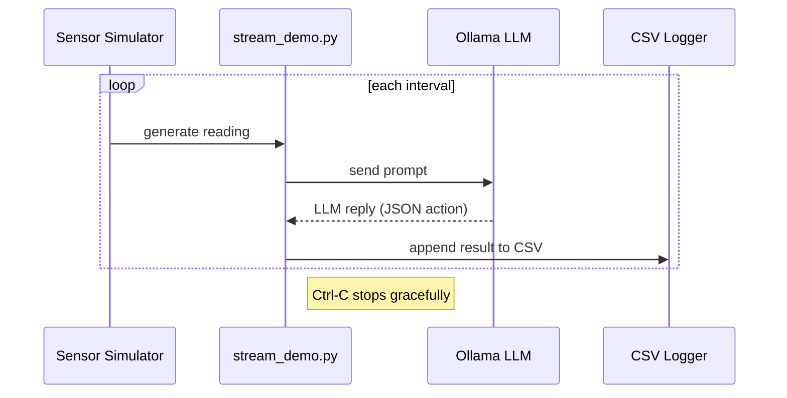
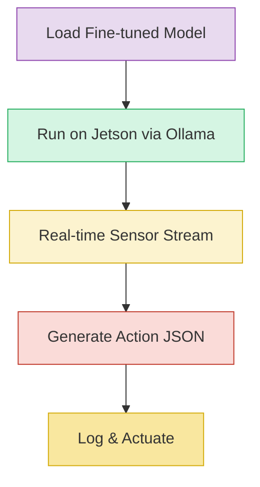

# EdgeIOT Project Diagrams

## 1. Overall System Architecture
```mermaid
flowchart TD
    A[Sensor Simulators] -->|raw data| B[Data Ingestion]
    B --> C[Preprocessing & Feature Engineering]
    C --> D[Baseline LLM Inference (Ollama)]
    D --> E[Action Extraction]
    E --> F[CSV Logging]
    F --> G[Visualization/Dashboard]
    style A fill:#D6EAF8,stroke:#2E86C1,stroke-width:2px
    style B fill:#FCF3CF,stroke:#D4AC0D,stroke-width:2px
    style C fill:#FADBD8,stroke:#C0392B,stroke-width:2px
    style D fill:#D5F5E3,stroke:#27AE60,stroke-width:2px
    style E fill:#E8DAEF,stroke:#8E44AD,stroke-width:2px
    style F fill:#F9E79F,stroke:#D4AC0D,stroke-width:2px
    style G fill:#F2F4F4,stroke:#7B7D7D,stroke-width:2px
```

## 2. Demo Streaming Loop


## 3. Training Data Generation Pipeline
```mermaid
flowchart LR
    A[Simulated Sensor Logs] --> B[Prompt Construction]
    B --> C[LLM Response Collection]
    C --> D[Parse & Validate JSON]
    D --> E[Dataset CSV (prompt, response)]
    style A fill:#AED6F1,stroke:#1B4F72
    style B fill:#F9E79F,stroke:#B7950B
    style C fill:#D5F5E3,stroke:#1D8348
    style D fill:#FADBD8,stroke:#922B21
    style E fill:#E8DAEF,stroke:#6C3483
```

## 4. QLoRA Fine‑Tuning Workflow
```mermaid
flowchart TB
    subgraph Preparation
        A[Load Dataset CSV]
        B[Tokenize with HuggingFace]
        C[Create 4‑bit Quantized Model]
    end
    subgraph FineTuning
        D[Apply QLoRA adapters]
        E[Train on GPU (Jetson)]
        F[Validate & Save Model]
    end
    A --> B --> C --> D --> E --> F
    style Preparation fill:#F5B7B1,stroke:#922B21
    style FineTuning fill:#85C1E9,stroke:#154360
```

## 5. Inference after Fine‑Tuning


## 6. ML Evaluation & Benchmarking
```mermaid
flowchart LR
    Benchmark[Benchmark script (benchmark.py)] --> Run[Run on Jetson with different models]
    Run --> Metrics[Collect latency, GPU usage, RAM]
    Metrics --> CSV[CSV report (benchmark_report.csv)]
    CSV --> Plot[Visualization (matplotlib)]
    Plot --> Report[PDF dissertation chapter]
    style Benchmark fill:#1e88e5,stroke:#90caf9;
    style Run fill:#1565c0,stroke:#90caf9;
    style Metrics fill:#0d47a1,stroke:#90caf9;
    style CSV fill:#1e88e5,stroke:#90caf9;
    style Plot fill:#1565c0,stroke:#90caf9;
    style Report fill:#0d47a1,stroke:#90caf9;
```
